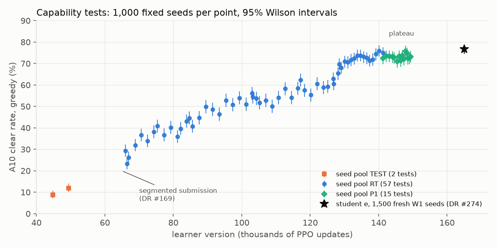

# Project overview

## The task

Slay the Spire 2 is a single-player, turn-based roguelike deck-builder. A run is about 50 floors and about 800 decisions. You start with a weak deck, fight your way up three acts, and collect cards, relics and potions along the way. At Ascension 10 (A10, the hardest setting this project targets) the final act ends with **two bosses back to back**; you win the run only if you beat both.

Decisions come in two kinds:

- **Combat** (about 85% of steps): which card to play, on which target, whether to drink a potion, when to end the turn.
- **Out-of-combat or "macro"** (about 15% of steps): map routing, which card reward to take or skip, shops, events, rest sites (heal or upgrade), relic choices. These decide the deck the combat policy must play with. Their effects show up floors or a whole act later.

Hidden information matters: the draw-pile order, the next encounters, and the random branches of monster behavior are not visible to the player. With a fixed seed the game is fully deterministic.

**Goal:** train the Defect character to clear A10 with a high win rate using **pure reinforcement learning**: no language model, no human gameplay data, self-play on the game's own rules code (DR #1, #26).

## Where it stands (2026-11-06)

| | |
|---|---|
| Best single network | **"student e"**: about **76–77%** greedy A10 clear rate (76.7% on 1,500 fresh seeds; about 75–77% on the 1,000-seed P1 pool) |
| Plain PPO main line | plateau at **72–74%** from about version 134k to 165k |
| Starting point of measured history | 8.8% at version 44,820 (2026-10-27) |
| Where it loses | about 53% of losses at the second Act-3 boss, 13.5% at the first Act-3 boss |
| Ceiling hint | a perfect-information solver wins both Act-3 bosses in 79.3% of the runs the agent lost there |
| External reference (secondhand) | best language-model agent about 35%, top humans about 95% on Defect A10 (Epoch AI, as cited in project docs; not re-verified) |
| Compute | 1 × RTX 4090 learner, 1 × RTX 3090 + a few hundred CPU game processes collecting; 6,000–10,000 decisions/s; about 6.7 billion decisions in total |
| Duration | 2026-10-24 to 2026-11-06 (two weeks) |
| Network | entity-set Transformer, d=256, 6 layers, about 19.4M parameters (4.74M in the encoder, the rest mostly embeddings) |

Training is currently **paused**. The last experiments were ceiling tests (DR #285–#286), an Act-3 double-boss specialist model whose two branches did not beat student e (DR #287), and a check of which fast simulator is faithful enough for search (DR #288).

## The approach in five sentences

1. **Run the real game, not a rewrite.** The rules live in the managed assembly `sts2.dll`; a headless .NET 9 host loads it and patches only the presentation layer (Harmony), so the training environment is the game ([03](03_system_and_infrastructure.md)).
2. **Every decision is "pick one of the legal candidates."** The engine lists candidates; the network scores each; softmax over the scores is the policy. No action mask, no fixed output layer ([04](04_observation_and_model.md)).
3. **A Transformer over entity records** (cards, creatures, relics, map nodes, options), with an asymmetric critic that may read hidden information the policy never sees ([04](04_observation_and_model.md)).
4. **Asynchronous PPO** with two advantage chains (combat steps and out-of-combat decisions), curricula built from real run snapshots, and rewards that were shaped early and then stripped back to almost pure "clear the run" ([05](05_training_rewards_curriculum.md)).
5. **Evaluation as a first-class system:** deterministic greedy play on fixed seed pools, paired comparisons, power calculations, and a confirmation pool never used for selection ([06](06_evaluation_methodology.md)).

## What makes this project worth a collaborator's time

- A **faithful, deterministic, seedable** environment for a complex stochastic game with hidden information, including fork/branch tools that re-randomize only what the player cannot see (DR #258).
- **291 numbered decisions** with dates, the owner's instruction, the change, and the measured result, including every rollback and negative result. Most RL projects lose this record; here it is complete ([15](15_decision_log_index.md)).
- **Clean data for studying a plateau**: per-seed outcomes of 291 capability tests across dozens of checkpoints, the full learner log, and the weights of the snapshots involved. The plateau has been diagnosed in detail (policy churn × long deterministic runs; [09](09_plateau_and_churn.md)) but not solved.
- **Concrete open problems** with measured effect sizes, so a new idea can be sized before it is tried ([12](12_open_problems_and_collaboration.md)).

## What this project is not

- Not a polished library. The code was written fast, mostly by AI coding agents under the owner's direction, with Chinese comments and many one-off tools ([16](16_how_the_project_was_run.md)).
- Not peer-reviewed. Several key results come from single runs; some gains cannot be attributed to a single change ([11](11_evidence_gaps.md)).
- Not self-contained. Running the engine needs a legal copy of the game; game files and decompiled code are deliberately not in this repository.
