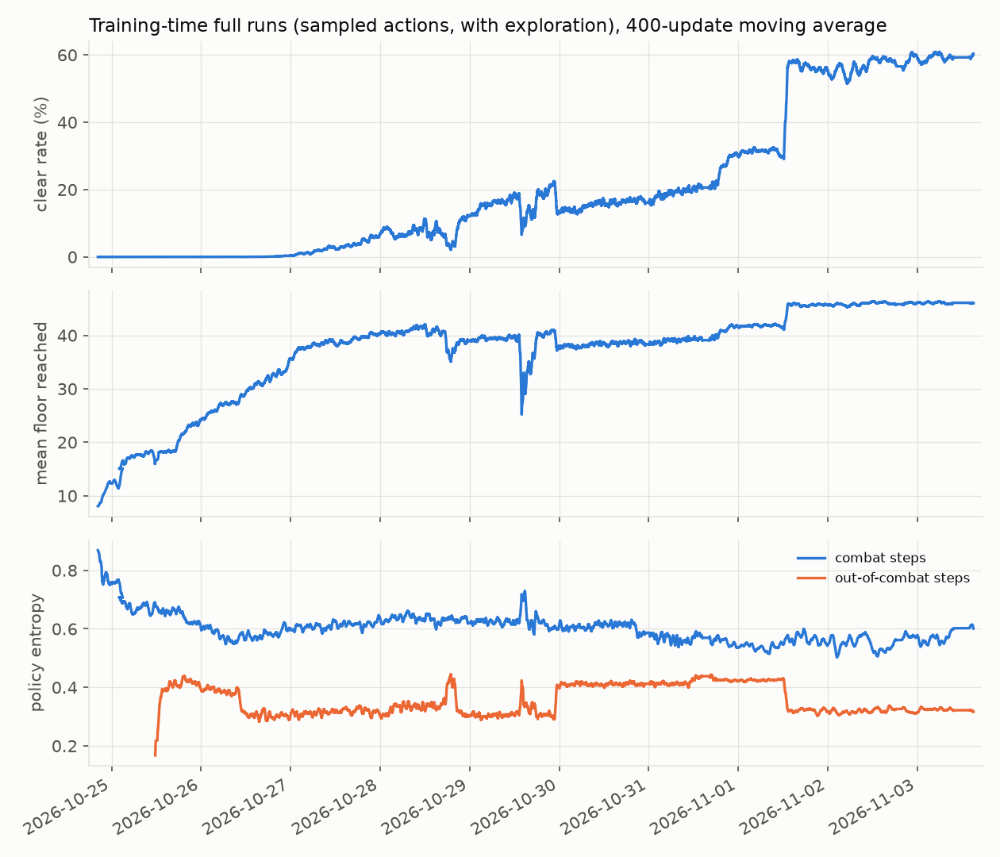

# Timeline and critical path

This page answers two questions: *what happened, in what order*, and *which steps actually moved the win rate*. The second question has a less tidy answer than the first, because many changes were launched together. Every claim below carries its evidence level:

- **Attributed**: a paired comparison isolates the change.
- **Confounded**: the number moved, but other changes landed in the same window.
- **Not shown**: tried and no measurable gain, or never measured cleanly.

Version numbers are learner versions (one PPO update each). Win rates are greedy A10 clear rates on 1,000 fixed seeds unless stated otherwise. Seed pools changed over time (TEST → RT → P1 → W1), so read the trend, not the differences between adjacent rows ([06](06_evaluation_methodology.md)).

## The path in one table

| Phase | Dates | Versions | Clear rate | What changed | Evidence |
|---|---|---|---|---|---|
| 0. Engine | 10-24 | — | — | Headless `sts2.dll`, candidate interface, observation format, training system | foundation |
| 1. First training | 10-25 | 0 → ~10k | ~0% (mean floor 8 → 18) | Training online; deck-building drift and rollback to v9,400; separate out-of-combat heads | — |
| 2. Representation sprint | 10-26 → 10-27 | 10k → 47k | 8.8% at v44,820 | Observation v3–v10, real-snapshot curriculum, LR 3e-4 → 1.5e-4, model growth to 6 layers, content prior | confounded |
| 3. Throughput and data intake | 10-28 → 10-29 | 47k → 85k | 11.9% → 29.4% → ~43% | Two-machine IMPALA-style collection, shaping removed, **segmented run submission**, observation v11–v15, Act-3 chain practice | segmented submission **attributed** (+16.8 pp); rest confounded |
| 4. Noise reduction | 10-30 → 10-31 | 85k → 130k | ~50% → 60.6% → 69.7% | Curriculum 75% full runs, observation v16–v19, LR down + bigger batches + gradient accumulation + EMA, learnability-weighted boss practice | confounded |
| 5. Plateau | 11-01 → 11-03 | 130k → 159k | 72–74% | LR trials, exploration removed, value probes, plateau diagnosis, deck-value potential, branch labelling | mostly not shown |
| 6. Ensembles and distillation | 11-04 → 11-05 | 159k → 168k | **76–77% (student e)** | Value-side add-ons (no gain), attention expansion (regression), ensemble +3 pp, **pool distillation +3.5 pp** | distillation **attributed** |
| 7. Ceiling tests | 11-06 | paused | — | Solver ceiling 79.3% of Act-3 losses winnable; specialist model (no gain); simulator fidelity for search | — |

*Training-time full runs use sampled actions and, until 2026-11-01, forced random out-of-combat picks. The jump on 11-01 coincides with removing forced exploration (DR #231), which changed what these sampled runs measure; greedy evaluation did not jump. Versions repeat after rollbacks, so the x-axis is wall-clock time. The log stops on 11-03 because the full statistics stopped being pulled to the workstation after DR #254.*

## Phase by phase

### Phase 0 — 2026-10-24: a faithful engine in one day

- M0 ran `sts2.dll` headlessly; M1 completed the full-run loop. The key choices (DR #2, #7, #8, #10–#15): load the real game logic, stub only Godot/UI, run all async continuations on one thread for determinism, and wrap every player choice as "decision point + candidate list".
- Fidelity work: 130 methods that read `TestMode` were audited and the branches that change content were fixed; game logic hidden in the UI layer was reproduced and tracked by an audit list (`engine/audit/`).
- The observation format (DR #19–#21), the append-only vocabulary, and the training system (learner + actors, concatenated-array trajectories) were designed the same day.
- Measured cost: about 1.3 ms per engine decision; network inference and learning, not simulation, dominate CPU cost (DR #25). That shaped the rest of the engineering effort.
- Scope narrowed from five characters to the Defect (DR #26).

### Phase 1 — 2026-10-25: training starts and immediately drifts

- Training went live on a rented 3090 with a mix of full runs and combat practice (DR #37).
- Deck-building emphasis (DR #65): out-of-combat advantages computed along their own decision chain, plus a "deck-score head" whose changes were paid out as reward. Within about 900 versions the run degraded (mean floor 18.4 → 13.75 in training, evaluation ~21 → 12.4). **Rolled back to v9,400** and redesigned (DR #67): out-of-combat decisions got their own policy and value heads on the shared encoder; the deck score stopped paying reward. The root cause was never pinned down; the suspects are listed in DR #67.
- The game updated (v0.107.1 → v0.111.0); three engine fixes and training resumed the same day from v9,972 (DR #70). The append-only vocabulary made this cheap.
- Human-intuition reward shaping was added the same evening (deck-size potential, upgrade bonus, relic potential, potion costs; DR #74–#77). Almost all of it was removed later ([05](05_training_rewards_curriculum.md)).

### Phase 2 — 2026-10-26 → 10-27: representation sprint, forks, model growth

- Observation versions 3 → 10 in two days. Each came from a concrete failure: monster move previews (v3), map edges and per-step reachability (v5), event values (v6), route summaries (v7), rest-site numbers and no resting at full HP (v8), damage previews and the content prior (v9), and the end-of-turn preview (v10), added after a replay showed the model did not know orb passives resolve before enemy actions. All were added with **zero-initialized** input layers, so outputs were unchanged at launch.
- Practice moved to **real positions** from the agent's own runs (snapshots in the game's own save format, DR #64, #80) and toward Act-3 bosses as the bottleneck moved later.
- The two machines ran **forks with 750-version checks** (DR #103–#110): mid-run starts, practice shares, a lower learning rate (3e-4 → 1.5e-4) — the fork with the lower LR was adopted as main line.
- **Function-preserving growth** from 4 layers / FFN 512 to 6 layers / FFN 1,024 (DR #110). The grown model roughly tied the small one for 1,500 versions and was then adopted (DR #115, #118). No gain was ever demonstrated for the growth itself.
- DR #127 launched obs v9, the content prior, four reward changes and a new boss reward **at once, explicitly without a control**.
- First capability test: **8.8%** at A10 (A0: 92%; a cliff between A8 76% and A9 40%, DR #134, #156).
- Side tracks: a determinized-search testbed for boss fights (DR #125, #131), and a Rust rewrite of the rules core for speed (DR #136–#151), briefly used for collection and then dropped (DR #153).

### Phase 3 — 2026-10-28 → 10-29: throughput, data intake, and a run of rollbacks

- **Two-machine IMPALA-style training** (DR #157): B learns, A collects remotely and pulls weights; 5,800 → 8,000–8,500 steps/s. Learner sync removal and more local actors gave about 9,450 steps/s (DR #158).
- Shaping removed in steps: potion costs, upgrade and relic bonuses (DR #158), HP potential (DR #166), deck-size penalty (DR #174). The effect of each removal was not measured cleanly.
- **Segmented run submission** (DR #169) — the clearest single win of the project. Runs used to be sent to the learner only when finished; with a staleness cut per step, the start of long runs was systematically dropped (only ~34% of Act-1 steps and about half of out-of-combat decisions were learned from). Cutting runs into segments raised Act-1 intake to 77%. Paired on fresh seeds: **v63,680 12.6% → v66,040 29.4%, +16.8 ± 3.1 pp, 225 vs 57 one-sided wins, p < 0.001** (DR #170). Behavior changed too: more elites, more relics at the Act-3 boss, more card removals. Staleness limit 3 → 6 and a tighter queue then brought intake to 100% (DR #177–#178).
- Observation v11–v15, including privileged value inputs (pre-rolled next encounters, inferred next monster draw; DR #161).
- **Incidents**: all parameters became NaN at v68,160 (rollback, non-finite gradient guard; DR #173). Then a series of stacked reward/potential/entropy changes led to **four rollbacks to the same backup, v80,200** in one evening (DR #186–#192). The post-mortem: the comparison baseline was a cherry-picked peak, and several changes were mixed.
- **Act-3 chain practice** (DR #187): after winning the first Act-3 boss in practice, continue to the second with the HP and potions left, scored on both.
- Around 43% by v83,900.

### Phase 4 — 2026-10-30 → 10-31: evaluation discipline and noise reduction

- Evaluation moved to machine A on GPU with stratified seeds (DR #198); a **confirmation pool CF0000–9999** was created and never used for selection; sequential paired testing (SPRT) was introduced (DR #219).
- Curriculum switched to 75% full runs (DR #201); observation v16–v19 (DR #204–#210, #227), the last one adding a per-candidate "do I survive this turn if I do this and end the turn" feature.
- **Diagnosis that update noise dominated**: weight trajectories were indistinguishable from a random walk (net displacement / path length 0.021–0.034 vs 0.031 predicted for a random walk; DR #222). Response: LR 2.25e-4 → 1.1e-4, batch 32,768 → 65,536 steps, then gradient accumulation ×2 and ×4, EMA weights (DR #222–#230). Retests rose from about 63% to about 73% — **but observation v19 and other changes landed in the same window, so noise reduction cannot take all the credit**.
- **Learnability measurement**: replaying 2,100 Act-3 entry positions with 8 new seeds each showed about 12% were lost no matter what; boss practice was then sampled by [p̂(1−p̂)]³ (DR #224–#227).
- The **one-hour search test** (DR #217): PIMC on the two Act-3 bosses only, +6.7 ± 1.7 pp on 475 problems (≈ +5.7 pp per run). Offline distillation of that search into the network failed.
- 60.6% at v122,056; 69.7% at v128,517 (EMA weights).

### Phase 5 — 2026-11-01 → 11-03: the plateau

- 73.8% at v134,704, then flat at **72–74%** through ~v165k despite: an LR increase (reverted after 736 versions, DR #228–#229), removing forced out-of-combat exploration (DR #231), a larger gradient clip (DR #237), targeted combat exploration (DR #238–#239), halving the LR (DR #246), a deck-value potential (DR #253–#255), cross-segment out-of-combat advantages with λ 0.98 (DR #256–#257).
- **Diagnosis** (DR #252, [09](09_plateau_and_churn.md)): about 35% of seeds are coin flips for this policy family; differences between snapshots are butterfly effects of near-tie choices (median first divergence on floors 4–6, top-2 probability gap 0.017–0.043), not complementary skill. About half of Act-3 boss entries are already lost.
- **Branch labelling** of out-of-combat choices (DR #258–#260): in 7,101 paired continuations the policy's first choice was optimal (ties included) 90% of the time. Single out-of-combat choices are essentially right locally.

### Phase 6 — 2026-11-04 → 11-05: the only reliable gain after the plateau

- Three value-side additions at once (exogenous baseline, HL-Gauss head, combat auxiliary head; DR #261): no measurable gain.
- Out-of-combat attention expansion with surgical distillation (DR #262): regression (evaluation 73.3% → 69.6%), removed in DR #274.
- Archetype deviation: forcing any of seven deck archetypes loses 6–12 pp (DR #265).
- Out-of-combat-only training with same-seed groups: 72.1% → 73.2%, p = 0.55 (DR #267).
- **Ensembles**: probability-averaging 16 uniformly spaced snapshots +3.1 pp (p = 0.020, 1,500 fresh seeds; DR #272).
- **Pool distillation** (DR #273): the 16-snapshot ensemble distilled into one network, +3.5 pp over its starting snapshot (3,500 fresh seeds, p < 0.0001), on par with the ensemble, +5.0 over the then main line. Student e (same teacher, current structure) became the main line (DR #274): **about 76–77%**.
- Continued PPO from student e jittered around it and accumulated nothing (DR #275 addendum 3, #277).

### Phase 7 — 2026-11-06: ceilings and the next direction

- Heavy out-of-combat search on top of student e changed no choices in 25 searches (DR #285).
- **Perfect-information solver**: of 241 runs student e lost at the Act-3 bosses, 79.3% were winnable from the first boss's entry (DR #286). Combat play has headroom.
- An **Act-3 double-boss specialist** (warm start and reset branches) did not beat student e on a 1,392-problem held-out exam (DR #287).
- The Rust engine disagrees with C# on Act-3 boss chains (2.7% of chains fully consistent); search moved to `sts2-sim` (DR #288). After eleven fidelity patches, student e + PIMC on `sts2-sim` gained **+4.4 ± 1.5 pp** on 367 double-boss problems (p = 0.007). The next plan is to make that search fast and distill it into a boss-fight specialist.

## What actually moved the number

Ranked by how well the evidence supports the effect:

1. **Running the real game** (foundation). Not an experiment, but every number in this repo depends on it, and the one attempt to replace it with a faster rewrite (Rust) failed on exactly the hardest states.
2. **Segmented run submission** — attributed, +16.8 pp in one change. The lesson generalizes: check what fraction of each part of a long episode actually reaches the learner.
3. **Pool distillation** — attributed, +3.5 pp; the only post-plateau gain that held up on fresh seeds.
4. **Search at decision time** (+3 to +7 pp on the two Act-3 bosses; +4.4 on student e) — attributed, but not deployed: too slow for the training loop so far, and two distillation attempts did not generalize.
5. **Observation upgrades v3–v19, curriculum on real snapshots, the noise-reduction package, model growth, separate out-of-combat heads** — plausibly important, confounded. Several of these landed together; none was ablated alone.
6. **Reward shaping** — mostly removed; its early contribution to the cold start is plausible but unmeasured.
7. Everything after the plateau except distillation — not shown. See the [experiment ledger](07_experiment_ledger.md).
